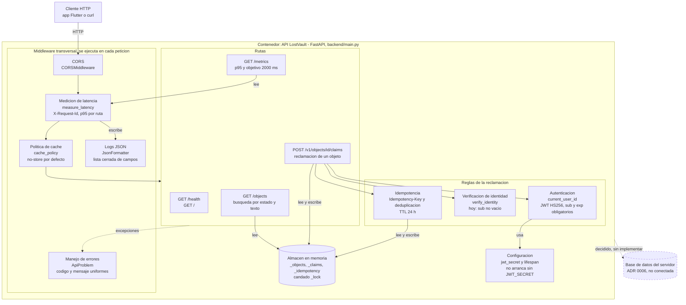

# C4 nivel 3 — Componentes de la API de LostVault

Este nivel hace zoom en el contenedor **API LostVault** del [C4 nivel 2](c4_nivel2.md): la aplicación FastAPI de `backend/main.py`, que corre en el servidor de la universidad ([ADR 0008](../adr/0008-plataforma-despliegue-universidad.md)). Muestra los componentes que existen hoy en el código, no los que se planean.

Línea continua = existe en el código; línea punteada = decidido, pendiente de conectar.

## Componentes

| Componente | Dónde está en el código | Responsabilidad | Estado / límite |
|---|---|---|---|
| CORS | `CORSMiddleware` en `app.add_middleware` | Permite que el cliente web llame a la API desde otro origen | Acepta cualquier origen (amenaza A8, riesgo bajo) |
| Medición de latencia | `measure_latency`, `_p95`, `_durations_by_endpoint` | Mide la duración de cada petición, agrupa por plantilla de ruta y calcula el p95 sobre una ventana de 500 muestras; devuelve `X-Request-Id` | Vive en la memoria del proceso: con más de un worker es por proceso (ver [arc42 §7](../arc42/07_vista_despliegue.md)) |
| Política de caché | `cache_policy`, `OBJECTS_CACHE_CONTROL` | Responde `no-store` por defecto y deja `GET /objects` cacheable (`s-maxage=30`) | Sin caché compartida delante de la API, solo afecta al navegador ([cache.md](../datos/cache.md)) |
| Manejo de errores | `ApiProblem`, `api_problem_handler` | Traduce los fallos del dominio a respuestas con código y mensaje (401, 404, 409, 422) | Alineado con el contrato `docs/contracts/lostvault-api.yaml` |
| Logs JSON | `JsonFormatter` | Escribe una lista cerrada de campos y nunca el token | Probado por `test_logs_never_contain_the_token` |
| Rutas de salud y métricas | `GET /`, `GET /health`, `GET /metrics` | Estado del servicio y p95 por endpoint con el objetivo del Escenario 4 (`objective_ms`, `met`) | `/health` aún no comprueba la base de datos; `/metrics` es público (A9) |
| Búsqueda | `GET /objects` (`search_objects`) | Lista objetos filtrando por `status` y `q` | Lee del almacén en memoria |
| Reclamación | `POST /v1/objects/{object_id}/claims` (`create_claim`) | Orquesta: sesión, clave de idempotencia, objeto, disponibilidad, identidad; crea la reclamación y marca el objeto como reclamado | Es el flujo del Escenario 3 (seguridad) |
| Autenticación | `current_user_id` | Valida el JWT (HS256, `sub` y `exp` obligatorios) y devuelve el usuario | Depende de `JWT_SECRET` (amenaza A2) |
| Verificación de identidad | `verify_identity` | Decide si la identidad es válida | Hoy solo comprueba que el `sub` no esté vacío (amenaza A1) |
| Idempotencia | `_idempotency`, `_purge_expired_keys` | Un reintento con la misma `Idempotency-Key` repite el 201 original; sin clave, un mismo usuario recibe 200 en vez de 409 | Solo protege dentro de un proceso (riesgo R1) |
| Almacén en memoria | `_objects`, `_claims`, `_idempotency`, `_lock` | Guarda los datos y serializa el acceso con un candado | Se pierde al reiniciar; la base de datos del servidor existe pero no está conectada (ADR 0006) |
| Configuración | `jwt_secret`, `lifespan` | Lee `JWT_SECRET` del entorno y hace fallar el arranque si falta | Sin secretos en el repositorio (A7) |

## Relación con la arquitectura documentada

Estos componentes son **lógicos**: todos viven en un solo archivo (`backend/main.py`), no en módulos separados como `lib/features/*` en el cliente Flutter. Por eso el backend no reproduce la frontera `public/` del [ADR 0001](../adr/0001-estilo-arquitectonico.md), lo que está registrado como no conformidad NC6 en `docs/ddd/auditoria_backend.md`. Este diagrama muestra dónde pasarían esas fronteras si se separara el archivo: reglas de la reclamación, almacén y transversales.

## Verificación

- Las rutas y el comportamiento de cada componente se prueban en `backend/test_api.py` (se ejecuta en CI con `backend.yml`).
- El flujo de la reclamación coincide con `docs/arc42/06_vista_runtime.md` y con `ClaimObjectUseCase` del cliente (mismo orden: sesión, objeto, disponibilidad, identidad).
