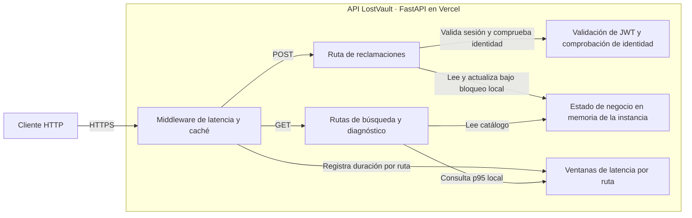

# C4 nivel 3 · Componentes de la API LostVault

Esta vista abre el contenedor FastAPI del [nivel 2](c4_nivel2.md). Los componentes son responsabilidades de [backend/main.py](../../backend/main.py) dentro de una función de Vercel. El cliente HTTP está fuera del contenedor.

| Componente | Implementación y responsabilidad |
|---|---|
| Middleware | `measure_latency` registra duración y emite logs estructurados. `cache_policy` aplica la política HTTP. |
| Rutas de lectura | `search_objects` atiende `GET /objects`. `health` y `metrics` atienden `GET /health` y `GET /metrics`. |
| Reclamaciones | `create_claim` atiende `POST /v1/objects/{object_id}/claims` y aplica las reglas de disponibilidad y reintento. |
| Sesión e identidad | `current_user_id` valida el JWT y exige `sub` y `exp`. `verify_identity` comprueba que el identificador tenga contenido. |
| Estado de negocio | `_objects`, `_claims` y `_idempotency` viven en memoria. `_lock` coordina el acceso dentro del proceso. |
| Ventanas de latencia | `_durations_by_endpoint` conserva muestras locales. `_p95` calcula el percentil por ruta. |

Un reinicio o el envío de una solicitud a otra instancia puede cambiar el estado observado. PostgreSQL y el publicador de eventos figuran como propuestas en el nivel 2. El cliente Flutter del corte local usa sus propios adaptadores en memoria.

[Contrato HTTP](../contracts/lostvault-api.yaml) · [Pruebas del backend](../../backend/test_api.py) · [Vista de despliegue](../arc42/07_vista_despliegue.md)
